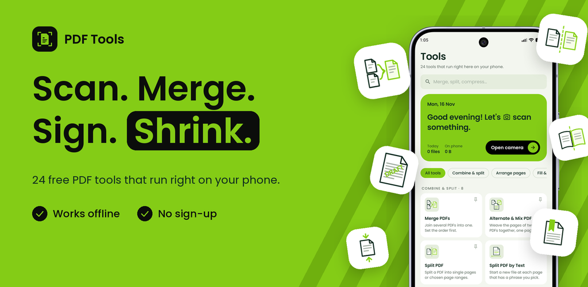

<p align="center">
  
</p>

<h1 align="center">PDF Tools</h1>

<p align="center">
  24 free PDF tools and a document scanner for Android.<br>
  Everything runs on your phone.
</p>

<p align="center">
  <a href="https://sammyzi.github.io/pdf-tools/">Privacy policy</a>
</p>

## What it does

- **Scan** documents, books, ID cards and whiteboards. Scans are searchable.
- **Combine and split**: merge, split, mix pages, zip.
- **Arrange pages**: reorder, rotate, crop, put several pages on one sheet.
- **Fill and mark up**: sign, watermark, page numbers, redact.
- **Protect and shrink**: compress, OCR, add or remove a password.
- **Automate**: chain tools and run them on many PDFs at once.
- **Read** PDFs in the built-in viewer and keep your files in folders.

Your files never leave your phone, and you don't need an account.

## Build

You need JDK 25 and the Android SDK. If JDK 25 is missing, Gradle downloads it.

```bash
./gradlew :app:assembleDebug      # build a debug APK
./gradlew :app:installRelease     # install a release build on a connected phone
./gradlew :app:testReleaseUnitTest
```

Release builds use your upload key from `~/.gradle/gradle.properties` (`PDF_TOOLS_UPLOAD_STORE_FILE`,
`PDF_TOOLS_UPLOAD_STORE_PASSWORD`, `PDF_TOOLS_UPLOAD_KEY_ALIAS`, `PDF_TOOLS_UPLOAD_KEY_PASSWORD`). Without it they
use the debug key.

Google Drive sync is off for now. Turn it on with `DRIVE_SYNC_ENABLED` in `Features.kt`.

## Built with

Kotlin, Jetpack Compose, PdfBox-Android, Jetpack PDF, CameraX, OpenCV and ML Kit.
See [THIRD_PARTY_NOTICES.md](THIRD_PARTY_NOTICES.md) for all licences.

## License

[MIT](LICENSE) © 2026 SammyZi
